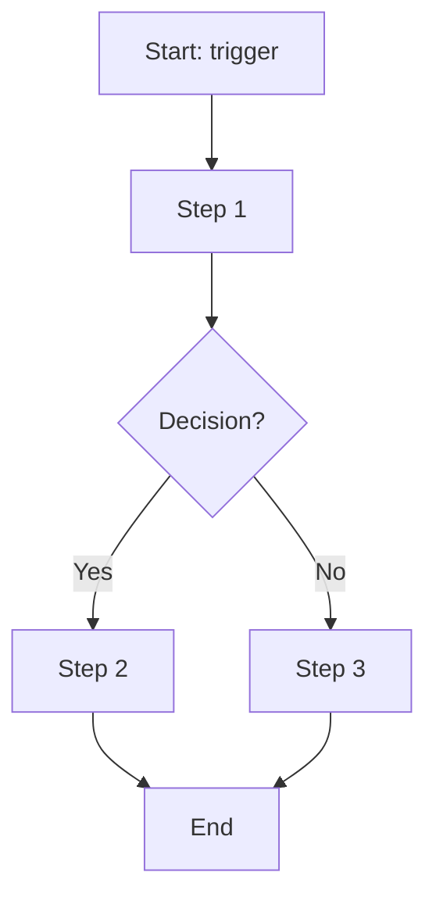
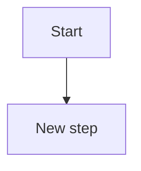
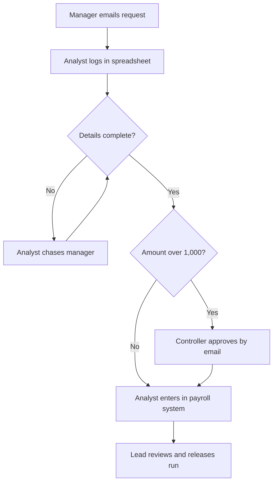

## How to use

Map the as-is process by walking through it with the people who do it, not from policy documents. Record who does each step, in which system, how long it takes, and where it goes wrong. Then design the to-be, and complete the gap analysis so every change traces to a requirement. Mermaid diagrams render on GitHub and in most Markdown tools; paste the step table into a spreadsheet if you prefer.

## Template

````markdown
# Process map: {{Process name}}

| Field | Value |
|---|---|
| Process owner | |
| Scope (start trigger -> end outcome) | |
| Frequency / volume | |
| Participants interviewed | |
| Version / date | |

## 1. As-is steps
| # | Actor / role | Step | System / tool | Input -> Output | Time (touch / elapsed) | Pain point or control |
|---|---|---|---|---|---|---|

## 2. As-is diagram


## 3. Pain points and root causes
| ID | Pain point | Impact (time, cost, risk) | Root cause |
|---|---|---|---|

## 4. To-be steps
(same columns as as-is, plus **Change type**: eliminate / automate / simplify / add control)

## 5. To-be diagram


## 6. Gap analysis
| Area | As-is | To-be | Gap / action | Requirement ID |
|---|---|---|---|---|
| People | | | | |
| Process | | | | |
| Systems | | | | |
| Data | | | | |
| Controls | | | | |

## 7. Benefits and metrics
| Metric | As-is | To-be target |
|---|---|---|

## 8. Open questions and assumptions
````

## Example (fictional)

````markdown
# Process map: Off-cycle payment request

| Field | Value |
|---|---|
| Process owner | Head of Payroll Operations |
| Scope | Manager request -> payment included in a pay run |
| Frequency / volume | About 400 requests/month |
| Participants interviewed | 3 payroll analysts, 2 managers, 1 finance controller |
| Version / date | v0.2, 2026-02-20 |

## 1. As-is steps
| # | Actor | Step | System | Input -> Output | Time (touch / elapsed) | Pain point or control |
|---|---|---|---|---|---|---|
| 1 | Manager | Emails request to payroll mailbox | Email | Free-text -> email | 10 min / - | Missing fields |
| 2 | Payroll analyst | Reads email, logs in tracker | Spreadsheet | Email -> row | 8 min / 1 day | Re-keying errors |
| 3 | Payroll analyst | Chases manager for missing detail | Email | Questions -> answers | 5 min / 1.5 days | Delay |
| 4 | Finance controller | Approves by reply (amounts > 1,000) | Email | Request -> approval | 3 min / 1 day | Approval not stored with record |
| 5 | Payroll analyst | Enters payment in payroll system | Payroll system | Row -> input | 6 min / - | Manual entry |
| 6 | Payroll lead | Reviews and releases run | Payroll system | Run -> paid | 20 min / - | Control: variance check |

## 2. As-is diagram


## 3. Pain points and root causes
| ID | Pain point | Impact | Root cause |
|---|---|---|---|
| P1 | 12% of requests need rework | ~160 hrs/month | Free-text intake |
| P2 | Approvals not auditable | Audit finding | Approval lives in email |

## 6. Gap analysis
| Area | As-is | To-be | Gap / action | Requirement |
|---|---|---|---|---|
| Process | Email intake | Structured form | Build request form | BR-001 |
| Controls | Email approval | Recorded dual approval | Approval workflow | BR-002 |
| Systems | Re-keying | Direct hand-off to pay run | Integration | BR-003 |

## 7. Benefits and metrics
| Metric | As-is | To-be target |
|---|---|---|
| Median days to pay | 3.5 | 1.5 |
| Rework rate | 12% | <3% |
````
